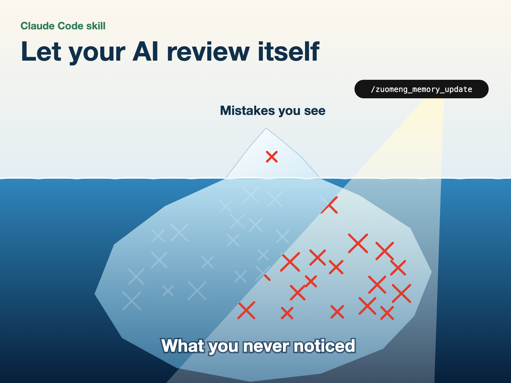

# /zuomeng_memory_update

A Claude Code skill that makes your AI look back at its own mistakes once a week, find the ones you never noticed, and get better on its own. "Zuomeng" (做梦) is Chinese for "dreaming".



## Why I made it

When the AI gets something wrong, most people notice it, correct it, and move on. But a lot of mistakes are buried. You don't even realize they're there, and fixing them could save you a lot of time later. Finding them can be automatic.

Memory has the same problem. Claude Code writes memory on its own while you talk to it, but it never goes back to update it. Some entries go out of date and just sit there, and the AI keeps reading them.

Anthropic has Dreams, which is built for this. But it's a Managed Agents API and can't read files on my laptop. So I rebuilt it as a Claude Code skill, following Anthropic's design.

## What it does

- Once a week, it reads the past week's sessions and finds mistakes that show up in different sessions, including the ones you never noticed.
- It checks your memory for entries that are out of date, wrong, duplicated, or contradict each other.
- Everything comes back as a list with evidence. Nothing changes until you approve each item, and it takes a snapshot first so you can roll back.
- Every change goes into a log. Next week it reads that log and checks whether the old mistakes still show up.

## How it works

- A small Python script (standard library only) compresses each new session into short text: your words, the tools called, errors and rejections. Secrets are masked.
- Subagents read the sessions in batches, in parallel. The main session merges what they find, groups mistakes by what the agent actually did (not by wording), and keeps only patterns that show up in at least 2 different sessions.
- Each proposal says which file it would change: CLAUDE.md, a memory file, or a skill.

The Sources table at the end of [SKILL.md](zuomeng_memory_update/SKILL.md) shows which parts come from Anthropic's design and which were added.

## Install

```bash
git clone https://github.com/Eriq7/claude-code-zuomeng.git
cp -R claude-code-zuomeng/zuomeng_memory_update ~/.claude/skills/
```

Then open `~/.claude/skills/zuomeng_memory_update/SKILL.md` and replace `<main-project-dir>` with your project's folder name under `~/.claude/projects/` (it looks like `-Users-you-code-myapp`).

## Use

Type `/zuomeng_memory_update` once a week. It only runs when you type it (it's set with `disable-model-invocation: true`).

## 中文版

Chinese original: [zh/zuomeng_memory_update/](zh/zuomeng_memory_update/). Install it the same way, just copy that folder instead.
